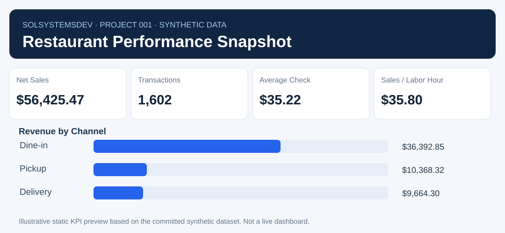

# Restaurant Performance Analytics

**Project 001 · Jonathon McDonnell · Python / pandas / SQL · Synthetic data**

A reproducible business-analytics demo translating order, menu and labor records into management KPIs, data-quality warnings and an executive-style report. The generated report is **not** an actual client or employer report.

## See the work in 30 seconds



**Synthetic demonstration:** **$56,425.47** net sales · **1,602** orders · **$35.22** average check · **$35.80** sales per paid labor hour.

**[View report source](reports/sample_performance_report.html)** · **[View methodology](docs/methodology.md)** · **[Inspect Python analytics](src/analytics.py)** · **[Inspect SQL](sql/restaurant_kpis.sql)** · **[Inspect tests](tests/test_analytics.py)**

The project also contains a self-contained HTML landing page at `docs/index.html`, ready for **GitHub Pages** once Pages is enabled in repository Settings → Pages → Deploy from a branch → `main` / `/docs`. Until then, GitHub may show HTML source rather than a rendered page.

### What I built

- Joined order-level, line-item, menu and labor-shift records without multiplying order discounts.
- Produced channel sales, average check, sales per paid labor hour and cost-data coverage measures.
- Added validation for duplicate keys, missing cost data and incomplete guest counts.
- Delivered reproducible Python/pandas logic, SQLite-compatible example queries, HTML reporting and automated tests.
- Kept incomplete costs explicit instead of inventing contribution margin or full profitability.

> **Scope:** All records and results are synthetic. The DAX definitions are illustrative; no verified Power BI `.pbix` is included.

---

## What this project demonstrates

- Designing relational data at **order**, **order-item**, **menu-SKU**, and **labor-shift** grains.
- Writing input validation rules and reporting **data quality warnings**.
- Avoiding double-counting order-level discounts when joining items.
- Calculating **net sales, average check, sales by channel, and sales per paid labor hour**.
- Using menu-cost coverage to prevent unsupported profit claims.
- Rendering a portable **management-style HTML report** and JSON metrics.
- Reproducing reporting logic in **SQLite-compatible SQL** and example **Power BI DAX**.
- Unit-testing KPI calculations with GitHub Actions.

## Sample report

Open [`reports/sample_performance_report.html`](reports/sample_performance_report.html) locally in your browser to view the sample management report. GitHub's file viewer may show HTML source rather than render it.

The HTML report is self-contained, responsive, and generated from the included CSV files. The project deliberately reveals missing recipe cost data and missing guest covers rather than masking the uncertainty.

## Quick start

Requires Python 3.10+.

```bash
python -m pip install -r requirements.txt
python data/generate_synthetic.py
python -m unittest discover -s tests -v
python -m src.generate_report
```

The last command refreshes:
- `reports/sample_performance_report.html`
- `reports/sample_metrics.json`

Optional SQLite demo:

```bash
python -m src.load_sqlite
```

Run the queries in [`sql/restaurant_kpis.sql`](sql/restaurant_kpis.sql) against `data/restaurant_demo.sqlite` using a SQLite client. The local SQLite file is ignored by Git.

## Repository contents

```text
restaurant-performance-analytics/
├── README.md
├── requirements.txt
├── data/
│   ├── README.md
│   ├── generate_synthetic.py
│   ├── orders.csv
│   ├── order_items.csv
│   ├── menu_costs.csv
│   └── labor_shifts.csv
├── src/
│   ├── analytics.py
│   ├── generate_report.py
│   └── load_sqlite.py
├── sql/
│   └── restaurant_kpis.sql
├── powerbi/
│   └── MEASURES.md
├── reports/
│   ├── sample_metrics.json
│   └── sample_performance_report.html
├── docs/
│   └── methodology.md
└── tests/
    └── test_analytics.py
```

## Assumptions and known limitations

- The data model excludes sales tax, gratuities, third-party fee settlements, and occupancy expenses.
- `direct_hourly_wages` means modeled paid hours × nominal hourly rates, **not** fully loaded labor cost.
- A menu SKU intentionally has missing cost data: therefore **overall food cost, contribution margin and profit are not reported**.
- Cover counts are missing for some dine-in orders. Pickup/delivery covers are intentionally not populated. The demo therefore does not compute revenue per customer.
- DAX examples are illustrative; no `.pbix` file or Power BI dashboard is claimed.

Full definitions: [`docs/methodology.md`](docs/methodology.md).

## Planned development

- v0.2: operational data-readiness scorecard and exception monitoring.
- v0.3: staffing coverage, daypart performance, and scenario modeling.
- v0.4: more sophisticated menu-engineering and Power BI model instructions.

## Author

**Jonathon McDonnell** · [SolSystemsDev](https://github.com/SolSystemsDev)  
Business Intelligence · Data Analytics · AI & Automation

**License:** No license has been granted yet; viewing the repository does not automatically permit reuse or redistribution. A license can be added if the project is later released as open source.
